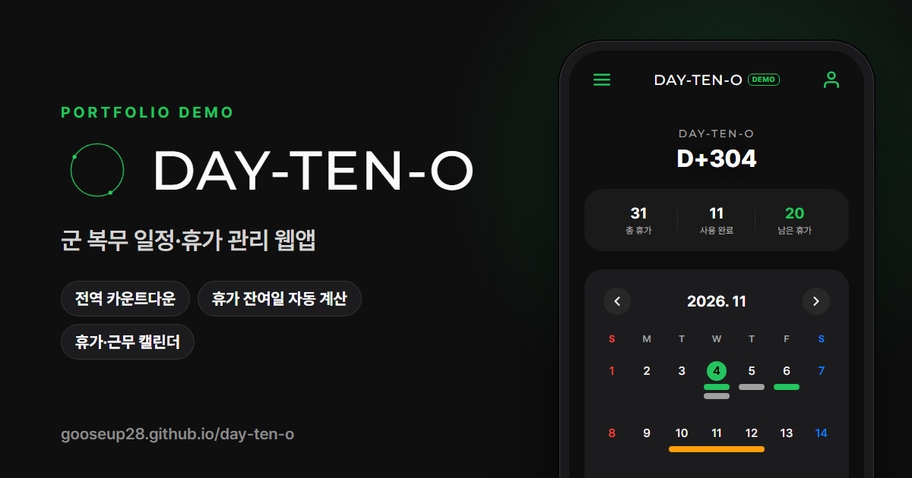

# DAY-TEN-O 데모

군 복무 중에 만든 일정·휴가 관리 웹앱 **DAY-TEN-O**의 포트폴리오용 데모입니다.

**데모: https://gooseup28.github.io/day-ten-o/**

- 전역 카운트다운: 입대일만 넣으면 전역일, 실시간 복무율, 남은 일과일(주말·공휴일·휴가 제외) 계산
- 휴가 관리: 연가·포상·위로 휴가를 받은 내역별로 관리하고, 일정으로 쓰면 자동 차감
- 휴가·근무 캘린더: 외출·외박·휴가와 당직·CCTV·위병소 근무를 따로 관리
- 공휴일 표시: 설·추석 연휴와 대체공휴일까지 규칙대로 계산
- 그 밖에: 밀어서 수정·삭제, 밝게·어둡게(기기 설정 따라감), 테마 색 8가지, 글자 크기 3단계

## 개선한 점

- 남은 일과일 계산: 이미 일정으로 잡아 둔 휴가 날이 일과일로 그대로 세어지던 계산을 고쳤어요.
- 화면 구멍 막기: 일정 제목·메모·직접 만든 일정 종류 이름에 이상한 글자가 들어와도 코드로 실행되지 않게 했어요.
- 알림 정리: 브라우저 알림 권한을 묻지 않고, 앱 안 안내 문구와 iOS식 확인창으로 바꿨어요.

## 데모에 대해

- 서버 없이 동작합니다. 입력한 데이터는 방문자 브라우저(localStorage)에만 저장됩니다.
- 처음 열면 오늘 날짜를 기준으로 샘플 데이터가 채워지고, 설정 맨 아래 '데모 초기화'로 언제든 되돌릴 수 있습니다.
- 원본 앱은 Supabase로 실시간 동기화·공유 달력·암호 잠금을 지원하며, 데모에서는 이 기능만 뺐습니다.

## 파일 구성

| 파일 | 역할 |
| --- | --- |
| `index.html` | PC용 소개 페이지 (휴대폰 틀 안에 앱 표시). 휴대폰에서는 `app.html`로 바로 이동 |
| `app.html` | 앱 본체 (HTML · CSS · Vanilla JS) |
| `demo.js` | Supabase 클라이언트와 같은 모양으로 동작하는 브라우저 저장소 DB + 샘플 데이터 |
| `og-image.png` | 링크 미리보기용 대표 이미지 (1200×630) |
